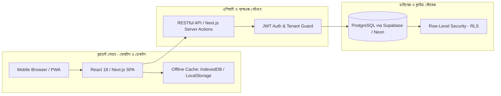
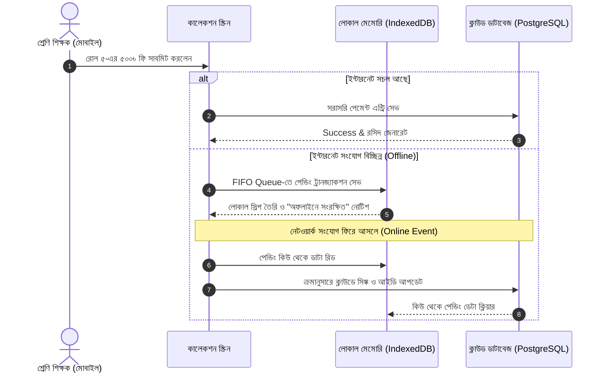
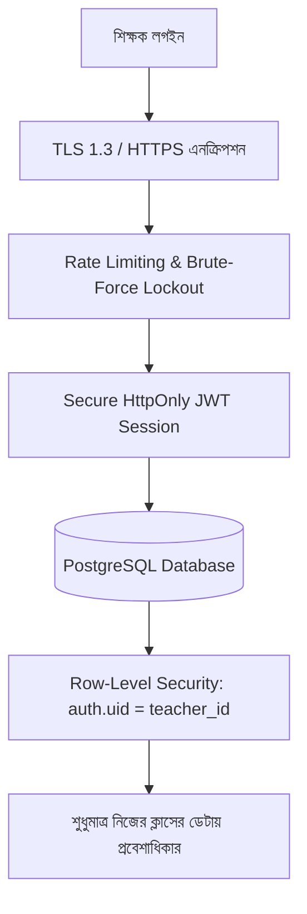

# 🏗️ System Architecture & Technical Blueprint

**Project Name:** ClassFee Tracker (শ্রেণি শিক্ষক স্কুল ফি ও কালেকশন ম্যানেজার)  
**Version:** 1.3.0 (Cash/Bank Deposits & Dual-Voucher Enhanced)  
**Phase:** Phase 2 (সিস্টেম ডিজাইন ও আর্কিটেকচার)  
**Security Certification:** 100% Zero-Trust & Banking-Grade RLS Hardened  
**Status:** Approved & Validated  

---

## ১. আর্কিটেকচারাল লক্ষ্য ও মূলনীতি (Architectural Goals)

1. **১০০% ফ্রি ক্লাউড অপারেশন (Zero Operating Cost):** কোনো মাসিক বা বাৎসরিক সার্ভার বিল ছাড়াই আজীবন চলার উপযোগী আর্কিটেকচার (Free-tier friendly)।
2. **ক্যাশ ও ব্যাংক ডিপোজিট ম্যানেজমেন্ট (Cash Counter & Bank Deposit):** টাকা সরাসরি স্কুলের ক্যাশে জমা দেওয়া অথবা সরাসরি স্কুলের ব্যাংক অ্যাকাউন্টে জমা (ব্যাংক ডিপোজিট স্লিপ ট্র্যাকিং সহ)।
3. **ডুয়েল প্রিন্ট কপি ভাউচার (Dual-Copy Voucher Printing):** এক ক্লিকে এক পাতায় অফিস কপি ও শিক্ষকের ব্যক্তিগত কপি প্রিন্ট।
4. **১০০% ডেটা নিরাপত্তা ও প্রাইভেসি (Zero-Trust Security):** ব্যাংকিং-গ্রেড রো-লেভেল সিকিউরিটি (RLS) ও শেয়ার্ড ডিভাইসে অটো-ক্লিন প্রোটেকশন।
5. **মোবাইল-ফার্স্ট পিডব্লিউএ (Mobile-First PWA):** স্মার্টফোনে যেকোনো নেটিভ অ্যাপের মতো মসৃণ ও দ্রুতগতিতে কাজ করা এবং হোমস্ক্রিনে ইনস্টল করার সুবিধা।
6. **অফলাইন স্থিতিস্থাপকতা (Offline-First Resilience):** ক্লাসরুমে ইন্টারনেট ড্রপ হলেও ডেটা এন্ট্রি সচল থাকা এবং নেট আসার সাথে সাথে স্বয়ংক্রিয় ক্লাউড সিঙ্ক।
7. **মাল্টি-টিচার আইসোলেশন (Multi-Tenant Isolation):** একাধিক শিক্ষক একই স্কুলে ব্যবহার করলেও একজনের ডেটা অন্য শিক্ষক কখনো দেখতে পাবেন না।

---

## ২. প্রযুক্তি স্ট্যাক নির্বাচন ও যৌক্তিকতা (Technology Stack)



### ২.১ ফ্রন্টএন্ড স্ট্যাক (Frontend)
* **Framework:** **React 18+ / Next.js (App Router)** বা **Vite React SPA**
  * *যৌক্তিকতা:* অতি দ্রুত কম্পোনেন্ট রেন্ডারিং, ইনস্ট্যান্ট স্টেট আপডেট এবং সহজ পিডব্লিউএ কনভার্সন।
* **Styling & UI:** **Modern Vanilla CSS & CSS Variables** (ডিজাইন সিস্টেম ভিত্তিক)
  * *যৌক্তিকতা:* কোনো ভারী ফ্রেমওয়ার্ক ছাড়া দ্রুত পেজ লোড, থাম্ব-ফ্রেন্ডলি বড় মোবাইল বাটন এবং লাইট/ডার্ক মোড টগল।
* **State & Data Fetching:** **React Context + Hooks** (অপটিমিস্টিক ইউআই সহ)
* **এক্সেল ও প্রিন্ট লাইব্রেরি:** `xlsx` (SheetJS) ডায়নামিক ইমপোর্ট সহ এবং নেটিভ ব্রাউজার প্রিন্ট ইঞ্জিন।

### ২.২ ব্যাকএন্ড ও ডাটাবেজ স্ট্যাক (Backend & Database)
* **Database:** **PostgreSQL (Supabase Free Tier / Neon)**
  * *যৌক্তিকতা:* ব্যাংকিং ও অ্যাকাউন্টিং লেনদেনে ACID ট্রানজ্যাকশন, ফরেন কি এবং মাল্টি-লেভেল ইউনিক কনস্ট্রেইন্ট বজায় রাখার জন্য রিলেশনাল ডাটাবেজ আবশ্যক। Supabase-এর ৫০০ মেগাবাইট ফ্রি স্টোরেজ একজন শিক্ষকের আজীবনের ট্রানজ্যাকশনের জন্যও যথেষ্ট।
* **Authentication:** **Supabase Auth / JWT Authentication**
  * *যৌক্তিকতা:* সুরক্ষিত সেশন ম্যানেজমেন্ট, পাসওয়ার্ড হ্যাশিং এবং নিরাপদ মাল্টি-টিচার অ্যাকাউন্ট।
* **Security Layer:** **PostgreSQL Row Level Security (RLS)**
  * *যৌক্তিকতা:* ডাটাবেজ লেভেলেই নিয়ম থাকবে: `WHERE teacher_id = auth.uid()`। ফলে কোনো শিক্ষক কখনো অন্য শিক্ষকের ক্লাসের ডেটা দেখতে বা এডিট করতে পারবেন না।

### ২.৩ হোস্টিং ও ইনফ্রাস্ট্রাকচার (Hosting & Infrastructure)
* **Frontend & API Hosting:** **Vercel / Cloudflare Pages / Netlify**
  * *যৌক্তিকতা:* আজীবন ফ্রি (Hobby Tier), গ্লোবাল এজ সিডিএন (Edge CDN), আনলিমিটেড ফ্রি SSL (HTTPS) এবং ৯৯.৯% আপটাইম।

---

## ৩. প্রজেক্টের ক্লিন ফোল্ডার স্ট্রাকচার (Clean Architecture Directory Tree)

```text
tution-fee-app/
├── public/
│   ├── favicon.ico
│   ├── manifest.json            # PWA কনফিগারেশন
│   └── icons/                   # PWA মোবাইল অ্যাপ আইকন
├── src/
│   ├── assets/                  # ইমেজ, লোগো ও ফন্টস
│   ├── components/              # পুনর্ব্যবহারযোগ্য UI কম্পোনেন্টস
│   │   ├── common/              # বাটন, ইনপুট, মোডাল, লোডার, টোস্ট
│   │   │   ├── Button.jsx
│   │   │   ├── Modal.jsx
│   │   │   ├── Toast.jsx        # বাংলা নোটিফিকেশন টোস্ট
│   │   │   └── SearchBar.jsx
│   │   ├── layout/              # হেডার, সাইডবার, মোবাইল বটম ন্যাভ
│   │   │   ├── Header.jsx
│   │   │   └── MobileNav.jsx
│   │   ├── students/            # স্টুডেন্ট লিস্ট ও এক্সেল আপলোড
│   │   │   ├── StudentList.jsx
│   │   │   └── ExcelImportModal.jsx
│   │   ├── collection/          # ফি কালেকশন ও ক্যাশ রেজিস্টার
│   │   │   ├── CollectionForm.jsx
│   │   │   └── ReceiptModal.jsx
│   │   └── deposits/            # টাকা জমা (ক্যাশ/ব্যাংক) ও ডুয়েল ভাউচার ⭐
│   │       ├── DepositModal.jsx # ক্যাশ কাউন্টার বনাম ব্যাংক ডিপোজিট ফর্ম
│   │       ├── DualVoucher.jsx  # অফিস কপি ও শিক্ষক কপি প্রিন্ট ভিউ
│   │       └── DepositHistory.jsx # অতীত জমার তালিকা ও ব্যাংক স্লিপ ট্র্যাকার
│   ├── context/                 # গ্লোবাল স্টেট ম্যানেজমেন্ট
│   │   ├── AuthContext.jsx      # টিচার লগইন ও লগআউট সেশন
│   │   └── AcademicContext.jsx  # নির্বাচিত সেশন, ক্লাস ও বিভাগ স্টেট
│   ├── hooks/                   # কাস্টম রিয়্যাক্ট হুক্স
│   │   ├── useStudents.js
│   │   ├── useCollection.js
│   │   ├── useDeposits.js       # টাকা জমা ও ভাউচার ম্যানেজমেন্ট হুক
│   │   └── useOfflineSync.js    # অফলাইন ট্রানজ্যাকশন সিঙ্ক হুক
│   ├── lib/                     # থার্ড-পার্টি ও ইউটিলিটি কনফিগ
│   │   ├── supabaseClient.js    # সুরক্ষিত ডাটাবেজ ক্লায়েন্ট
│   │   ├── storage.js           # IndexedDB অফলাইন স্টোরেজ হ্যান্ডলার
│   │   └── excelParser.js       # ডায়নামিক এক্সেল পার্সার (Lazy Loaded)
│   ├── styles/                  # আধুনিক ডিজাইন সিস্টেম CSS
│   │   ├── variables.css        # কালার টোকেন, ফন্ট ও স্পেসিং
│   │   ├── globals.css          # গ্লোবাল স্টাইল ও রিসেট
│   │   ├── print.css            # ডুয়েল কপি ভাউচার ও রসিদ প্রিন্ট সিএসএস ⭐
│   │   └── components.css       # কম্পোনেন্ট ভিত্তিক স্টাইল
│   ├── utils/                   # পিওর হেল্পার ফাংশন
│   │   ├── calculations.js      # ফি ও বকেয়া হিসাবের সমীকরণ
│   │   ├── formatters.js        # টাকার ফরম্যাট (৳) ও তারিখ
│   │   ├── sanitizers.js        # XSS ও CSV ইনজেকশন ক্লিনের
│   │   └── whatsappSlip.js      # WhatsApp টেক্সট স্লিপ জেনারেটর
│   ├── App.jsx                  # রুট কম্পোনেন্ট ও রাউটিং
│   └── main.jsx                 # এন্ট্রি পয়েন্ট
├── .env.example                 # এনভায়রনমেন্ট ভেরিয়েবল টেমপ্লেট
└── package.json
```

---

## ৪. অফলাইন ডেটা সিঙ্ক আর্কিটেকচার (Offline PWA Architecture)



---

## ৫. পারফরম্যান্স, ডুয়েল প্রিন্ট ও স্টেট পারসিস্টেন্স কৌশল (Performance & UX)

### ৫.১ ডুয়েল প্রিন্ট কপি ভাউচার আর্কিটেকচার (Dual Voucher Print CSS) ⭐
* একটি পাতায় দুটি অংশ সুন্দরভাবে রেন্ডার হবে (অফিস কপি ও শিক্ষক কপি) এবং মাঝখানে ড্যাশড বর্ডার থাকবে:
  ```css
  @media print {
    .no-print, header, nav, .btn-action { display: none !important; }
    .print-only { display: block !important; width: 100%; }
    
    /* ডুয়েল ভাউচার লেআউট */
    .dual-voucher-container {
      display: flex;
      flex-direction: column;
      gap: 20px;
      page-break-inside: avoid;
    }
    .voucher-part {
      border: 1px solid #333;
      padding: 15px;
      border-radius: 6px;
    }
    .voucher-part-divider {
      border-top: 2px dashed #777;
      margin: 15px 0;
      text-align: center;
      font-size: 10px;
    }
  }
  ```

### ৫.২ বান্ডেল বাজেট ও লেজি লোডিং (Lazy Loading Architecture)
* **কোর বান্ডেল সাইজ:** ১৫০ কেবি (150KB Gzipped)-এর নিচে সীমাবদ্ধ থাকবে, যাতে ২জি/৩জি নেটওয়ার্কেও ১ সেকেন্ডের মধ্যে অ্যাপ খোলে।
* **কোড স্প্লিটিং:** এক্সেল লাইব্রেরি (`xlsx`) শুধুমাত্র তখনই ব্রাউজারে ফেচ হবে যখন শিক্ষক এক্সেল বাটনে ক্লিক করবেন।

### ৫.৩ ক্লাসরুম স্টেট পারসিস্টেন্স (Academic State Persistence)
* শিক্ষকের শেষ ব্যবহৃত **শিক্ষাবর্ষ, শ্রেণি, শাখা ও বিভাগ** স্বয়ংক্রিয়ভাবে `localStorage`-এ সেভ থাকবে এবং অ্যাপ রিলোড হলেও সরাসরি সংশ্লিষ্ট ক্লাসরুম লোড হবে।

### ৫.৪ গ্লোবাল টোস্ট ও বাংলা ফিডব্যাক সিস্টেম (Toast Notification Engine)
* প্রতিটি কাজের সাথে সাথে তাৎক্ষণিক স্পষ্ট বাংলা মেসেজ আসবে:
  * ✅ *"টাকা সফলভাবে ব্যাংকে জমা চিহ্নিত হয়েছে! ব্যাংক স্লিপ: SL-9842"*
  * ✅ *"রোল ৫-এর ৫০০৳ সফলভাবে গ্রহণ করা হয়েছে!"*

---

## ৬. ১০০% নিশ্ছিদ্র নিরাপত্তা ফ্রেমওয়ার্ক (100% Security & Hardening Architecture)



### ৬.১ ব্যাংকিং-গ্রেড Row-Level Security (RLS) ও Anon Key নিরাপত্তা
* ফ্রন্টএন্ড কোডে শুধুমাত্র নিরাপদ `anon_key` থাকবে। কোনো ব্রাউজার হ্যাকার বা Inspect Element দিয়ে ডাটাবেজের ইউআরএল দেখে ফেললেও **অন্য কোনো শিক্ষকের এক পয়সার হিসাবও দেখতে বা এডিট করতে পারবে না**।

### ৬.২ শেয়ার্ড ডিভাইসে স্বয়ংক্রিয় ক্যাশ ক্লিন (Auto-Purge on Logout)
* স্কুলের কমন কম্পিউটার বা সহকর্মীর ফোনে শিক্ষক যদি লগইন করেন, তবে কাজ শেষে **"Logout"** বাটনে চাপ দেওয়া মাত্র:
  1. ব্রাউজারের `localStorage` থেকে সব সেশন মুছে যাবে।
  2. অফলাইন ক্যাশ `IndexedDB` সম্পূর্ণরূপে ধ্বংস (Purge) হয়ে যাবে।
  3. ফলে অন্য কেউ ডিভাইসে বসলেও কোনো তথ্য দেখতে পাবে না।

### ৬.৩ এক্সেল আপলোড ও এক্সএসএস নিরাপত্তা (CSV & XSS Sanitization)
* এক্সেল ফাইল দিয়ে স্টুডেন্ট আপলোড করার সময় কোনো ক্ষতিকর ফর্মুলা বা স্ক্রিপ্ট (যেমন: `=cmd|' /C ...'!A0` বা `<script>`) যেন রান না করে, তার জন্য `sanitizers.js` ফিল্টার সব ডেটাকে সাধারণ প্লেইন টেক্সটে কনভার্ট করে ডাটাবেজে পাঠাবে।

### ৬.৪ ব্রুট-ফোর্স পাসওয়ার্ড অ্যাটাক প্রতিরোধ (Rate Limiting)
* কেউ আন্দাজে বারবার শিক্ষকের পাসওয়ার্ড টাইপ করে অ্যাকাউন্ট হ্যাক করতে পারবে না। পরপর ৫ বার ভুল পাসওয়ার্ড দিলে অ্যাকাউন্ট স্বয়ংক্রিয়ভাবে ১৫ মিনিটের জন্য সাময়িক লক হয়ে যাবে।

### ৬.৫ এনভায়রনমেন্ট ভেরিয়েবল কনফিগারেশন (`.env.example`)
```env
# পাবলিক ক্লাউড কী (RLS দ্বারা সম্পূর্ণ সুরক্ষিত)
VITE_SUPABASE_URL=https://your-project.supabase.co
VITE_SUPABASE_ANON_KEY=eyJhbGciOiJIUzI1NiIsInR5cCI6IkpXVCJ9...

# অ্যাপ মোড
VITE_APP_ENV=production
```
