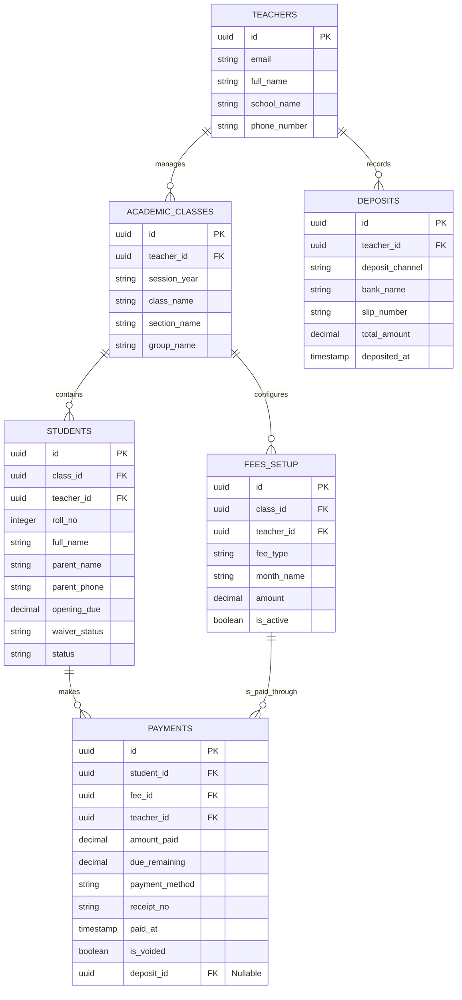

# 🗂️ Database Schema & ERD

**Project Name:** ClassFee Tracker (শ্রেণি শিক্ষক স্কুল ফি ও কালেকশন ম্যানেজার)  
**Phase:** Phase 2 (সিস্টেম ডিজাইন ও ডাটাবেজ - Step 7)  
**Database:** PostgreSQL (Supabase)  
**Status:** Draft

---

## ১. এন্টিটি রিলেশনশিপ ডায়াগ্রাম (ERD)

---

## ২. টেবিল স্ট্রাকচার (Table Structure)

*নোট: প্রতিটি টেবিলে `teacher_id` থাকবে RLS (Row Level Security) এবং মাল্টি-ট্যানেন্সি নিশ্চিত করার জন্য।*

### 2.1 `teachers` (Profiles)
শিক্ষকদের অথেনটিকেশন ও বেসিক প্রোফাইল।
| কলাম | টাইপ | কনস্ট্রেইন্টস | বিবরণ |
| :--- | :--- | :--- | :--- |
| `id` | `uuid` | PK, References `auth.users` | Supabase Auth ID |
| `email` | `text` | UNIQUE, NOT NULL | শিক্ষকের ইমেইল |
| `full_name` | `text` | NOT NULL | শিক্ষকের নাম (রসিদে প্রিন্ট হবে) |
| `school_name` | `text` | NOT NULL | স্কুলের নাম (রসিদে প্রিন্ট হবে) |
| `phone_number` | `text` | NULL | অভিভাবকের সাথে যোগাযোগের জন্য |
| `created_at` | `timestamptz` | DEFAULT now() | অ্যাকাউন্ট তৈরির সময় |

### 2.2 `academic_classes` (শ্রেণি ও শাখা)
শিক্ষকের সেটআপ করা ক্লাস, সেকশন এবং গ্রুপ।
| কলাম | টাইপ | কনস্ট্রেইন্টস | বিবরণ |
| :--- | :--- | :--- | :--- |
| `id` | `uuid` | PK, Default `uuid_generate_v4()` | ইউনিক আইডি |
| `teacher_id` | `uuid` | FK, NOT NULL | `teachers.id` |
| `session_year` | `text` | NOT NULL | যেমন: "2026", "2027" |
| `class_name` | `text` | NOT NULL | যেমন: "Class 9", "Class 10" |
| `section_name` | `text` | NULL | যেমন: "Section A", "Section B" |
| `group_name` | `text` | NULL | যেমন: "Science", "Commerce" |
| `created_at` | `timestamptz` | DEFAULT now() | |

*(Unique Constraint: `teacher_id`, `session_year`, `class_name`, `section_name`, `group_name`)*

### 2.3 `students` (শিক্ষার্থী)
প্রতিটি ক্লাসের স্টুডেন্ট লিস্ট।
| কলাম | টাইপ | কনস্ট্রেইন্টস | বিবরণ |
| :--- | :--- | :--- | :--- |
| `id` | `uuid` | PK | ইউনিক আইডি |
| `teacher_id` | `uuid` | FK, NOT NULL | RLS Security |
| `class_id` | `uuid` | FK, NOT NULL | `academic_classes.id` |
| `roll_no` | `integer` | NOT NULL | রোল নম্বর |
| `full_name` | `text` | NOT NULL | স্টুডেন্টের নাম |
| `parent_name` | `text` | NULL | পিতার/মাতার নাম |
| `parent_phone` | `text` | NULL | WhatsApp এর জন্য |
| `opening_due` | `numeric` | DEFAULT 0 | আগের বছরের বকেয়া |
| `waiver_status` | `text` | DEFAULT 'None' | 'None', 'Half-Free', 'Full-Free' |
| `status` | `text` | DEFAULT 'Active' | 'Active', 'TC', 'Inactive' |

*(Unique Constraint: `class_id`, `roll_no`)*

### 2.4 `fees_setup` (কাস্টম ফি)
যেসব ফি কালেকশন করা হবে তার তালিকা।
| কলাম | টাইপ | কনস্ট্রেইন্টস | বিবরণ |
| :--- | :--- | :--- | :--- |
| `id` | `uuid` | PK | ইউনিক আইডি |
| `teacher_id` | `uuid` | FK, NOT NULL | RLS Security |
| `class_id` | `uuid` | FK, NOT NULL | কোন ক্লাসের ফি |
| `fee_type` | `text` | NOT NULL | যেমন: 'Monthly', 'Exam', 'Session' |
| `month_name` | `text` | NULL | যেমন: 'January', 'February' (if monthly) |
| `amount` | `numeric` | NOT NULL | ফি এর পরিমাণ |
| `is_active` | `boolean` | DEFAULT true | ফি সচল আছে কিনা |

### 2.5 `payments` (ফি কালেকশন / ক্যাশ রেজিস্টার)
স্টুডেন্টদের থেকে গ্রহণ করা ফি এর রেকর্ড।
| কলাম | টাইপ | কনস্ট্রেইন্টস | বিবরণ |
| :--- | :--- | :--- | :--- |
| `id` | `uuid` | PK | ইউনিক আইডি |
| `teacher_id` | `uuid` | FK, NOT NULL | RLS Security |
| `student_id` | `uuid` | FK, NOT NULL | `students.id` |
| `fee_id` | `uuid` | FK, NULL | `fees_setup.id` (if specific fee) |
| `amount_paid` | `numeric` | NOT NULL | পরিশোধিত পরিমাণ |
| `due_remaining` | `numeric` | NOT NULL | অবশিষ্ট বকেয়া |
| `receipt_no` | `text` | UNIQUE, NOT NULL | রসিদ নম্বর (যেমন: REC-1001) |
| `payment_method` | `text` | DEFAULT 'Cash' | 'Cash', 'bKash', 'Nagad' |
| `is_voided` | `boolean` | DEFAULT false | ভুল এন্ট্রি হলে true |
| `void_reason` | `text` | NULL | বাতিলের কারণ |
| `deposit_id` | `uuid` | FK, NULL | `deposits.id` (ব্যাংকে জমা হলে) |
| `paid_at` | `timestamptz` | DEFAULT now() | পেমেন্টের সময় |

### 2.6 `deposits` (ক্যাশ ক্লোজিং ও ব্যাংক জমা)
শিক্ষক দিন শেষে বা সপ্তাহ শেষে মোট যে টাকা স্কুলকে বা ব্যাংকে জমা দেন।
| কলাম | টাইপ | কনস্ট্রেইন্টস | বিবরণ |
| :--- | :--- | :--- | :--- |
| `id` | `uuid` | PK | ইউনিক আইডি |
| `teacher_id` | `uuid` | FK, NOT NULL | RLS Security |
| `deposit_channel` | `text` | NOT NULL | 'Cash Counter', 'Bank' |
| `bank_name` | `text` | NULL | যদি ব্যাংকে জমা হয় |
| `slip_number` | `text` | NULL | ব্যাংক স্লিপ নম্বর |
| `total_amount` | `numeric` | NOT NULL | জমার মোট পরিমাণ |
| `deposited_at` | `timestamptz` | DEFAULT now() | জমার সময় |

---

## ৩. পরবর্তী ধাপ
ডাটাবেজ স্কিমা ডিজাইন সম্পন্ন হয়েছে। পরবর্তী ধাপে (`dfd.md`) আমরা ডাটা ফ্লো ডায়াগ্রাম তৈরি করব যা পুরো সিস্টেমের ডেটা কিভাবে প্রসেস হয় তা দেখাবে।
