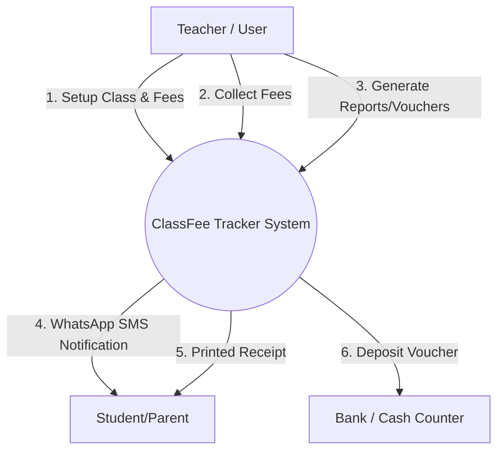
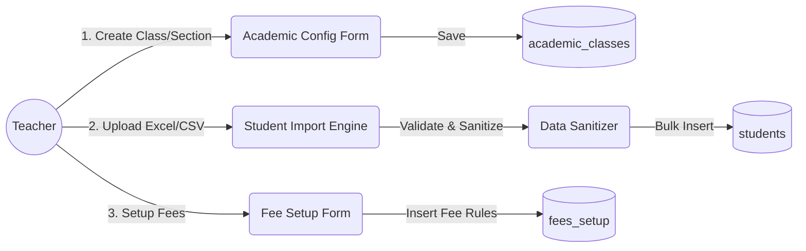
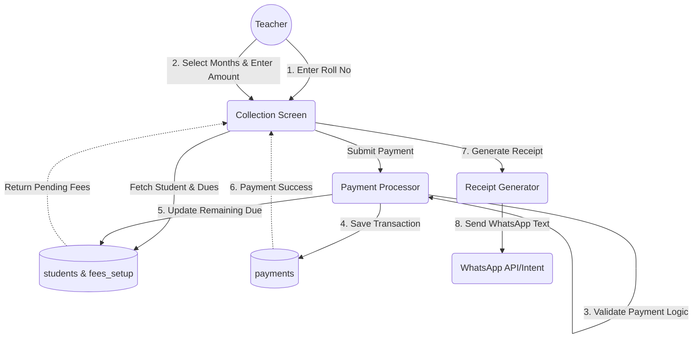
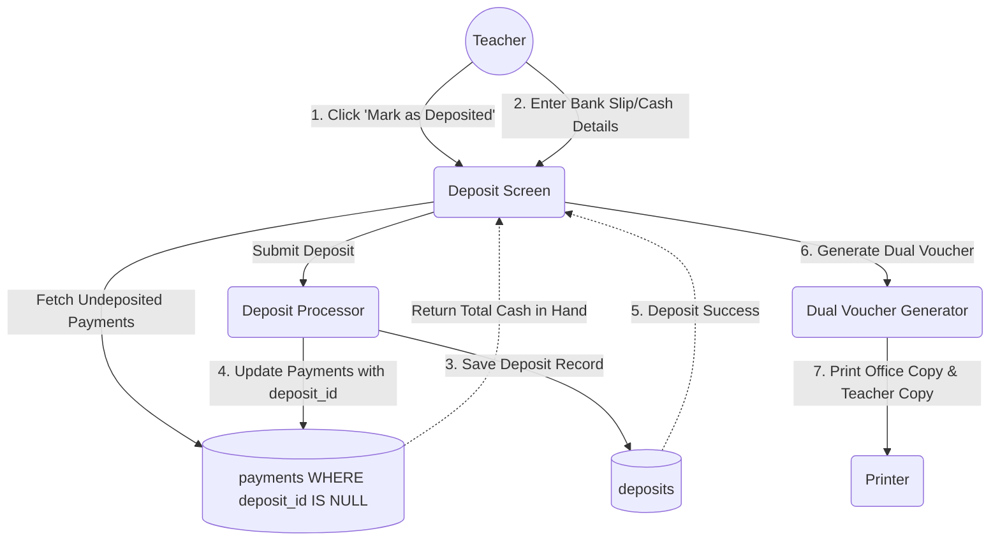
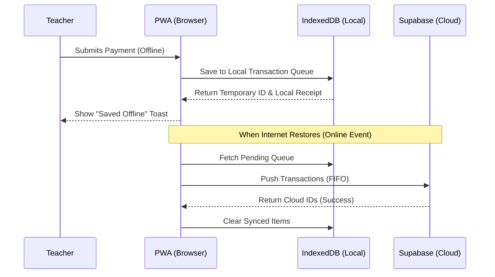

# 🔄 Data Flow Diagram (DFD)

**Project Name:** ClassFee Tracker (শ্রেণি শিক্ষক স্কুল ফি ও কালেকশন ম্যানেজার)  
**Phase:** Phase 2 (সিস্টেম ডিজাইন ও ডাটাবেজ - Step 8)  
**Status:** Draft

---

## ১. হাই-লেভেল ডাটা ফ্লো (Context Diagram - Level 0)

পুরো সিস্টেমটি কীভাবে বাহ্যিক এন্টিটি (যেমন: শিক্ষক, স্টুডেন্ট) এর সাথে ডেটা আদান-প্রদান করে তার ওভারভিউ।



---

## ২. মডিউল-ভিত্তিক বিস্তারিত ডাটা ফ্লো (Level 1 DFD)

### ২.১ একাডেমিক ও স্টুডেন্ট এন্ট্রি ফ্লো (Academic Setup & Student Entry)
কীভাবে একজন শিক্ষক নতুন সেশন শুরু করেন এবং স্টুডেন্ট আপলোড করেন।



### ২.২ ফি কালেকশন ফ্লো (Fee Collection Flow)
যখন একজন স্টুডেন্ট টাকা দিতে আসে, তখন সিস্টেম কীভাবে কাজ করে।



### ২.৩ ক্যাশ ক্লোজিং ও ব্যাংক ডিপোজিট ফ্লো (Deposit & Dual Voucher Flow) ⭐
শিক্ষক কীভাবে সংগৃহীত টাকা ব্যাংকে বা স্কুলের ক্যাশে জমা দেন এবং ডুয়েল ভাউচার প্রিন্ট করেন।



### ২.৪ ভুল পেমেন্ট বাতিল ഫ্লো (Void/Reversal Flow)
ভুল করে অন্য রোল বা ভুল অ্যামাউন্ট এন্ট্রি করলে কীভাবে রিভার্স হয়।

```mermaid
graph LR
    T((Teacher)) -->|1. Select Payment & Click Void| P1(Void Processor)
    P1 -->|2. Require Reason| UI(Void Reason Prompt)
    UI -->|Submit Reason| P1
    
    P1 -->|3. Update Payment (is_voided=true)| DB1[(payments)]
    P1 -->|4. Restore Student Due| DB2[(students)]
```

---

## ৩. অফলাইন ডাটা ফ্লো (Offline-First Architecture)
ইন্টারনেট সংযোগ না থাকলে সিস্টেম কীভাবে কাজ করবে।



---

## ৪. পরবর্তী ধাপ
ডাটা ফ্লো ডায়াগ্রাম (DFD) সম্পন্ন হয়েছে। পরবর্তী ধাপে (`api-spec.md`) আমরা ডাটা ফ্লো এর উপর ভিত্তি করে API/Server Actions গুলোর স্পেসিফিকেশন তৈরি করব।
