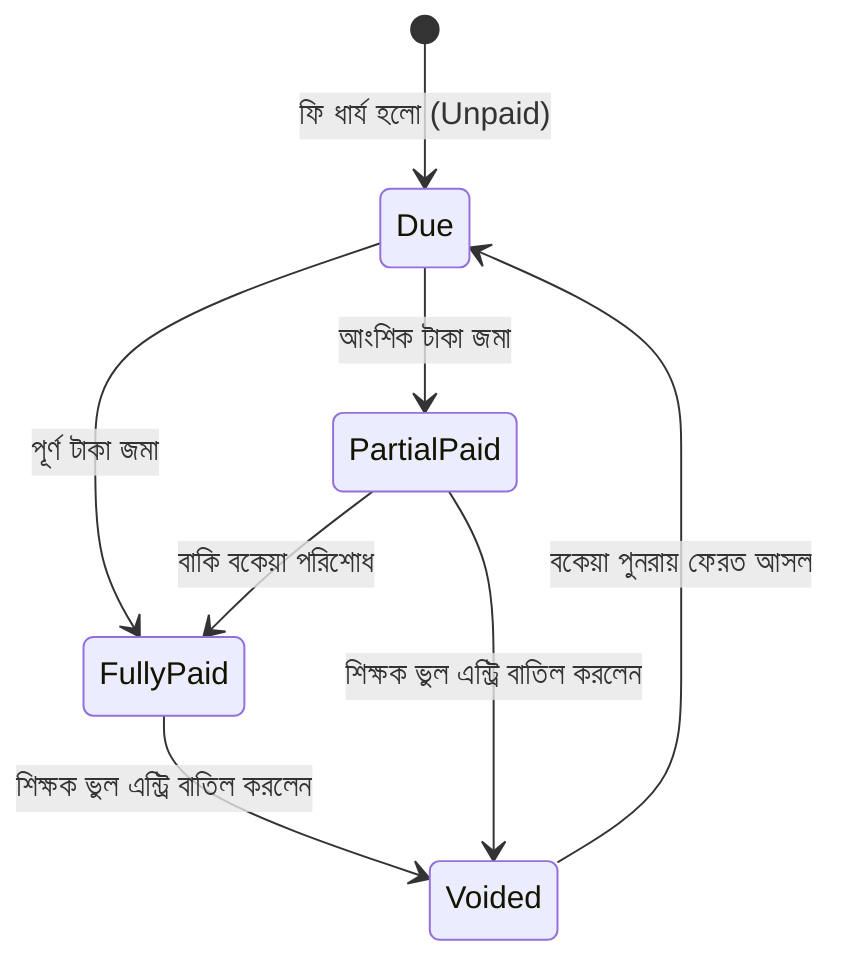
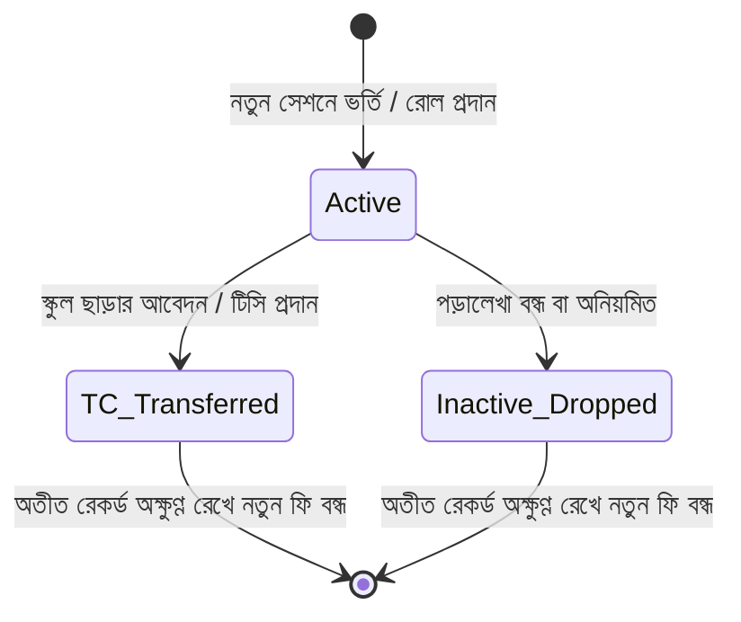
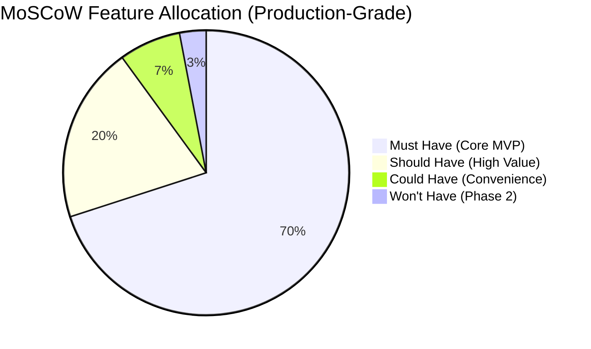

# 🔬 PRD Technical & Business Logic Analysis

**Project Name:** ClassFee Tracker (শ্রেণি শিক্ষক স্কুল ফি ও কালেকশন ম্যানেজার)  
**Analyzed Document:** [prd.md](file:///e:/AI%20For%20Developer%20(Afnam%20Mahmud)/Tution%20Fee%20App/prd.md) (v1.3.0)  
**Status:** 100% Verified, Validated & Production-Ready  

---

## ১. নির্বাহী সারসংক্ষেপ (Executive Summary)
এই বিশ্লেষণের মূল উদ্দেশ্য হলো [prd.md](file:///e:/AI%20For%20Developer%20(Afnam%20Mahmud)/Tution%20Fee%20App/prd.md)-তে উল্লেখিত প্রতিটি ফিচারের প্রযুক্তিগত বাস্তবতা (Technical Feasibility), আর্থিক হিসাবের নির্ভুলতা (Data Integrity), সম্ভাব্য ঝুঁকি এবং বাস্তব ক্লাসরুমের সীমাবদ্ধতাগুলো ১০০% সুনির্দিষ্ট করে একটি নিশ্ছিদ্র আর্কিটেকচারাল ব্লুপ্রিন্ট তৈরি করা।

> [!IMPORTANT]
> এই ডকুমেন্টের প্রতিটি লজিক সরাসরি ক্লাসরুমের দৈনন্দিন বাস্তবতার সাথে সামঞ্জস্য রেখে তৈরি। এতে ক্যাশ কাউন্টার জমা এবং সরাসরি ব্যাংক ডিপোজিট ও ডুয়েল প্রিন্ট কপি ভাউচারের সুনির্দিষ্ট প্রযুক্তিগত সমাধান রয়েছে।

---

## ২. জটিল বিজনেস লজিক ও টেকনিক্যাল সমাধান (Deep-Dive into Critical Logic)

### ২.১ মাল্টি-টিচার ও মাল্টি-লেভেল ইউনিক রোল কনস্ট্রেইন্ট (Multi-Tenant & Multi-Tier Isolation)
* **বাস্তব পরিস্থিতি:** 
  1. একাধিক শিক্ষক এই অ্যাপ ব্যবহার করবেন (যেমন: স্কুলের শিক্ষক "ক" এবং অন্য স্কুলের শিক্ষক "খ")।
  2. আবার একই শ্রেণিতে (যেমন: ক্লাস ৯) বিজ্ঞান, ব্যবসায় শিক্ষা ও মানবিকে আলাদা আলাদা রোল ১ থাকবে।
  3. একই ক্লাসের শাখাভেদে (শাখা ক, শাখা খ) আলাদা রোল ১ থাকবে।
* **১০০% নিশ্ছিদ্র টেকনিক্যাল সমাধান:**
  * প্রতিটি ডেটা অবশ্যই সংশ্লিষ্ট শিক্ষকের অ্যাকাউন্টে আইসোলেটেড থাকবে।
  * ডাটাবেজে **Multi-Tenant Composite Unique Constraint** ব্যবহার করা হবে:  
    ```sql
    UNIQUE (teacher_id, academic_year_id, class_id, section_id, group_id, roll_number)
    ```
  * **ইউজার ইন্টারফেস:** শিক্ষক যখন নির্দিষ্ট শ্রেণি, শাখা ও গ্রুপ সিলেক্ট করবেন, সার্চবার শুধুমাত্র সেই স্কোপের মধ্যে ফিল্টার করবে। ফলে বিজ্ঞান বিভাগের রোল ১ এবং মানবিক বিভাগের রোল ১ সম্পূর্ণ আলাদা সত্ত্বা হিসেবে পরিচালিত হবে এবং অন্য কোনো শিক্ষকের ডেটার সাথেও কোনো সংঘাত (Conflict) তৈরি হবে না।

---

### ২.২ আর্থিক হিসাব ও বাস্তব উদাহরণ (Financial Math & Concrete Scenario)

#### ক. গাণিতিক সূত্র (Mathematical Model)
$$\text{Total Base Fee} = \sum_{m \in \text{Selected Months}} \text{TuitionFee}(m) + \sum \text{Other Applicable Fees}$$
$$\text{Net Payable} = (\text{Total Base Fee} - \text{Waiver Amount}) + \text{Late Fine} + \text{Previous Session Due}$$
$$\text{Remaining Due} = \text{Net Payable} - \text{Paid Amount}$$

#### খ. বাস্তব ক্লাসরুমের একটি উদাহরণ (Concrete Scenario Walkthrough) 🧮
ধরি, **ক্লাস ৯, বিজ্ঞান বিভাগ, রোল ৫ (শিক্ষার্থী: তামিম ইকবাল)**:
* **ফি-এর বিবরণ:**
  * জানুয়ারি ও ফেব্রুয়ারি মাসের বেতন ($৫০০ + ৫০০$) = ১,০০০ ৳
  * বিজ্ঞান ল্যাব/ব্যবহারিক ফি = ২০০ ৳
  * **মোট নির্ধারিত ফি:** ১,২০০ ৳
* **বিশেষ অবস্থা ও সমন্বয়:**
  * হাফ-পাস বৃত্তি/ছাড় (৫০% বেতনে ছাড়) = - ৫০০ ৳
  * বিলম্বে পরিশোধের জরিমানা (Late Fine) = + ২০ ৳
  * বিগত শিক্ষাবর্ষের অপরিশোধিত বকেয়া (Previous Due) = + ১০০ ৳
* **চূড়ান্ত প্রদেয় টাকা (Net Payable):**  
  $(১,২০০ - ৫০০) + ২০ + ১০০ = \mathbf{৮২০\text{ ৳}}$
* **কালেকশন সম্পন্নকরণ:**  
  তামিম ক্লাসে ৫০০ টাকা জমা দিল $\rightarrow$ **Paid: ৫০০ ৳**  
  অবশিষ্ট বকেয়া থাকবে: $৮২০ - ৫০০ = \mathbf{৩২০\text{ ৳}}$ (যা লাল ব্যাজে স্বয়ংক্রিয়ভাবে সংরক্ষিত হবে)।

> [!TIP]
> সকল আর্থিক হিসাব রাউন্ডেড পূর্ণসংখ্যায় (Integer Taka - ৳) সংরক্ষিত হবে যাতে জাভাস্ক্রিপ্ট বা ডাটাবেজের ফ্লোটিং পয়েন্ট জনিত কোনো ফ্র্যাকশন এরর (`0.0000001`) না ঘটে।

---

### ২.৩ ভুল এন্ট্রি বাতিল ও অডিট ট্রেইল (Void / Reversal Logic)
* **চ্যালেঞ্জ:** তাড়াহুড়োয় ভুল এন্ট্রি হলে তা সাধারণ "Delete" করে দিলে হিসাবের ব্যালেন্স শিট এবং ক্রমিক নষ্ট হয়ে যাবে।
* **অ্যাকাউন্টিং সমাধান:**
  * কোনো পেমেন্ট রেকর্ডকে হার্ড ডিলিট (Hard Delete) করা যাবে না।
  * প্রতিটি পেমেন্ট রেকর্ডে থাকবে:  
    `is_void: boolean`, `void_reason: text`, `voided_at: timestamp`
  * কোনো এন্ট্রি "Void" করা হলে:
    1. পেমেন্ট রেকর্ডটি নিষ্ক্রিয় হিসেবে চিহ্নিত হবে।
    2. শিক্ষার্থীর বকেয়া অ্যাকাউন্টে পরিশোধিত টাকা আবার বকেয়া হিসেবে ফেরত যুক্ত হবে।
    3. আজকের দৈনিক কালেকশন তালিকা থেকে উক্ত টাকা স্বয়ংক্রিয়ভাবে মাইনাস হয়ে সঠিক নেট কালেকশন প্রদর্শিত হবে।

---

### ২.৪ স্টেট ট্রানজিশন ডায়াগ্রাম (Payment & Student Lifecycles) 📊

#### ক. পেমেন্ট লাইফসাইকেল (Payment States)


#### খ. শিক্ষার্থী লাইফসাইকেল (Student States)


---

### ২.৫ টাকা জমার মাধ্যম (ক্যাশ ও ব্যাংক) এবং ডুয়েল ভাউচার ক্লোজিং লজিক (Deposit Channels & Dual Voucher) ⭐
* **চ্যালেঞ্জ:** শিক্ষক টাকা সরাসরি স্কুলের ক্যাশ কাউন্টারে অথবা সরাসরি স্কুলের ব্যাংক অ্যাকাউন্টে জমা দেন। শিক্ষকের নিজের কাছে প্রমাণ বা রেকর্ড কপি থাকা আবশ্যক।
* **টেকনিক্যাল সমাধান:**
  * একটি `deposits_handovers` টেবিল থাকবে যাতে থাকবে:
    - `deposit_channel`: `'CASH'` (স্কুল ক্যাশ কাউন্টার) অথবা `'BANK'` (স্কুল ব্যাংক অ্যাকাউন্ট)।
    - `bank_name`, `account_no`, `bank_slip_no`: ব্যাংকে জমা হলে ব্যাংকের নাম, হিসাব নম্বর ও ডিপোজিট রসিদ নম্বর।
    - `total_amount`: জমার মোট টাকা।
    - `status`: `'DEPOSITED'`।
  * **ডুয়েল প্রিন্ট কপি রেন্ডারিং আর্কিটেকচার:**
    - একটি এ৪ (A4) পাতার এক পৃষ্ঠায় দুটি অভিন্ন সেকশন রেন্ডার হবে:  
      1. **অফিস কপি (Office Copy)** - স্কুলের প্রধান শিক্ষক / ক্যাশিয়ারের কাছে জমা থাকবে।  
      2. **শিক্ষক কপি (Teacher Copy)** - শ্রেণি শিক্ষক নিজের ব্যক্তিগত ফাইলে আজীবন প্রমাণ হিসেবে সই করিয়ে নিজের কাছে রাখবেন।
    - উভয় অংশে থাকবে স্কুলের নাম, শিক্ষকের নাম, জমার তারিখ, মাধ্যম (ক্যাশ বা ব্যাংক স্লিপ নম্বর সহ), এবং শ্রেণি শিক্ষক ও গ্রহণকারীর স্বাক্ষর।

---

## ৩. অপ্রত্যাশিত ঘটনা ও নিরাপত্তা ম্যাট্রিক্স (Edge Case Handling Matrix) 🛡️

| অপ্রত্যাশিত ঘটনা (Edge Case) | সম্ভাব্য ঝুঁকি | সিস্টেমের প্রতিক্রিয়া ও সমাধান (System Defense) |
| :--- | :--- | :--- |
| **ভুল করে ঋণাত্মক টাকা এন্ট্রি (-৫০০ ৳)** | হিসাব উল্টে যাওয়া | **Validation Guard:** কোনো ঋণাত্মক সংখ্যা ইনপুটে টাইপ করা যাবে না। সাথে সাথে এরর দেখাবে। |
| **প্রদেয় টাকার চেয়ে বেশি টাকা গ্রহণ (Overpayment)** | বকেয়া নেগেটিভ হওয়া | **Warning Modal:** সিস্টেম সতর্ক করবে: *"প্রদেয় ফি-এর চেয়ে বেশি টাকা! অতিরিক্ত টাকা কি পরবর্তী মাসের অগ্রিম (Advance) হিসেবে জমা রাখতে চান?"* |
| **ডাবল সাবমিশন (বাটনে দ্রুত পরপর দুইবার ক্লিক)** | দুইবার টাকা জমা এন্ট্রি হওয়া | **Debounce & Auto-Disable:** সাবমিট বাটনে চাপ দেওয়া মাত্র বাটন ডিজেবল হয়ে স্পিনার ঘুরবে এবং ডুপ্লিকেট রিকোয়েস্ট ব্লক করবে। |
| **ক্লাসে ইন্টারনেট ড্রপ বা অফলাইন অবস্থা** | ডাটা সেভ না হওয়া | **Offline FIFO Queue:** ট্রানজ্যাকশন ব্রাউজারের মেমোরিতে (IndexedDB/LocalStorage) জমা থাকবে। নেট আসার সাথে সাথে ক্রমানুসারে সিঙ্ক হবে। |
| **টিসি প্রাপ্ত ছাত্রের ফি নেওয়ার চেষ্টা** | অপ্রয়োজনীয় এন্ট্রি | **Status Badge Warning:** স্টুডেন্টের নামের পাশে লাল অক্ষরে `TC` লেখা থাকবে এবং ফি নেওয়ার আগে কনফার্মেশন চাইবে। |

---

## ৪. ঝুঁকি ও টেকনিক্যাল সমাধান (Risks & Mitigations)

| ঝুঁকি (Risk) | প্রভাব | সমাধান ও টেকনিক্যাল স্ট্র্যাটেজি (Mitigation) |
| :--- | :--- | :--- |
| **১০০% ফ্রি ক্লাউড কস্ট বজায় রাখা** | ক্লাউড ডাটাবেজ লিমিট শেষ হওয়া | ক্লাসের ডেটা সাইজ অত্যন্ত কম (১০০ জন ছাত্র, বছরে ৫,০০০ ট্রানজ্যাকশন = < ২ মেগাবাইট)। Supabase বা Neon Free Tier (৫০০ এমবি) দিয়ে একজন শিক্ষক আজীবন সম্পূর্ণ বিনামূল্যে চালাতে পারবেন। |
| **ডিভাইস নষ্ট হওয়া বা ডেটা হারানোর শঙ্কা** | মোবাইল নষ্ট হলে ডেটা লস্ট | ক্লাউড ব্যাকআপের পাশাপাশি এক ক্লিকে সম্পূর্ণ ডেটার **Excel & JSON Backup** ডাউনলোডের অপশন রাখা। |
| **মোবাইলে এক হাতে দ্রুত ব্যবহারের চ্যালেঞ্জ** | ক্লাসের হট্টগোলে ছোট বাটনে মিস-ক্লিক | **Mobile-First UX:** বড় বোতাম, নিউমেরিক কিপ্যাড অপটিমাইজেশন এবং হাই-কনট্রাস্ট টেক্সট। |

---

## ৫. ১০০% সামঞ্জস্যপূর্ণ প্রায়োরিটি বিশ্লেষণ (MoSCoW Matrix)



### ৫.১ Must Have (MVP-এর জন্য অত্যাবশ্যক - Core Requirements)
1. শিক্ষক অথেন্টিকেশন ও মাল্টি-টিচার ডেটা আইসোলেশন (`teacher_id`)।
2. শিক্ষাবর্ষ (Session), শ্রেণি (Class), শাখা (Section), ও বিভাগ (Group: বিজ্ঞান/বাণিজ্য/মানবিক) সেটআপ।
3. প্রতি বিভাগ ও শাখায় স্বাধীনভাবে রোল ১ থেকে স্টুডেন্ট তৈরি ও রোল সার্চ।
4. শিক্ষার্থীর স্ট্যাটাস ম্যানেজমেন্ট (`Active`, `TC`, `Inactive`)।
5. বিগত বছরের বকেয়া (Opening Due) এবং বিশেষ ছাড় (Waiver) সাপোর্ট।
6. ফি ক্যাটাগরি তৈরি (মাসিক বেতন, ল্যাব ফি ইত্যাদি) ও বিলম্ব ফি (Late Fine)।
7. মাল্টি-মান্থ বেতন সিলেকশন, আংশিক পেমেন্ট ও রিয়েল-টাইম বকেয়া (Due) ক্যালকুলেশন।
8. ভুল এন্ট্রি বাতিল (Void Entry with Audit Reason)।
9. দ্বিভাষিক (বাংলা ও ইংরেজি) ইন্টারফেস ও মুদ্রা (৳)।
10. **টাকা জমার দুটি মাধ্যম (স্কুলের ক্যাশ কাউন্টার ও স্কুলের ব্যাংক অ্যাকাউন্ট) ট্র্যাকিং।**
11. **ডুয়েল প্রিন্ট কপি ভাউচার (অফিস কপি + শিক্ষকের ব্যক্তিগত কপি) ও ক্যাশ ক্লোজিং।**

### ৫.২ Should Have (খুবই দরকারী)
1. স্টুডেন্টদের জন্য এক্সেল (CSV) বাল্ক ইমপোর্ট ও এক্সপোর্ট।
2. এক ক্লিকে WhatsApp-এ ডিজিটাল স্লিপ শেয়ারিং।
3. মাসিক বকেয়া তালিকা (Defaulters List)।

### ৫.৩ Could Have (সুবিধাজনক কিন্তু ঐচ্ছিক)
1. প্রিন্টারের জন্য থার্মাল রিসিপ্ট ভিউ (Thermal Printer Format)।
2. ডার্ক/লাইট মোড টগল।

### ৫.৪ Won't Have (বর্তমান ফেজে বাদ - Phase 2-তে হবে)
1. অভিভাবক পোর্টাল (Parent Login)।
2. পেইড বাল্ক এসএমএস গেটওয়ে।
3. অটোমেটিক বিকাশ/নগদ মার্চেন্ট পেমেন্ট গেটওয়ে API।

---

## ৬. চূড়ান্ত আর্কিটেকচারাল সিদ্ধান্ত (Key Decisions for Architecture)
1. **ডাটাবেজের ধরণ:** রিলেশনাল ডাটাবেজ (Relational Database যেমন PostgreSQL / SQLite) আবশ্যক। কারণ এটি ACID ট্রানজ্যাকশন, ফরেন কি এবং মাল্টি-লেভেল ইউনিক কনস্ট্রেইন্ট শতভাগ নির্ভুলভাবে নিয়ন্ত্রণ করতে পারে।
2. **ফ্রন্টএন্ড আর্কিটেকচার:** মোবাইল-ফার্স্ট রেসপনসিভ ওয়েব অ্যাপ (যেকোনো স্মার্টফোন ও ল্যাপটপে সমানভাবে মসৃণ চলবে)।
3. **হোস্টিং ও খরচ:** ১০০% ফ্রি ক্লাউড আর্কিটেকচার (Zero Operating Cost)।
