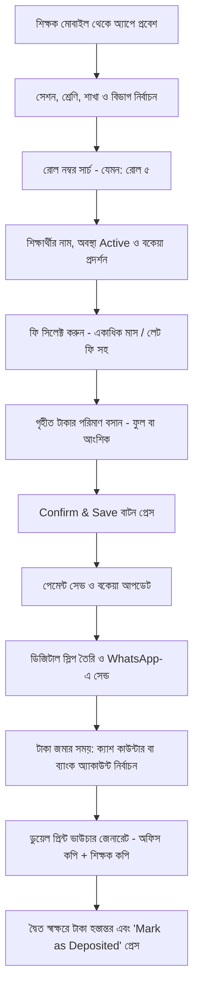

# 📋 Product Requirements Document (PRD)

**Project Name:** ClassFee Tracker (শ্রেণি শিক্ষক স্কুল ফি ও কালেকশন ম্যানেজার)  
**Version:** 1.3.0 (Deposit Channels & Dual Voucher Enhanced)  
**Status:** Approved  
**Target Users:** প্রাথমিক, মাধ্যমিক ও মাদ্রাসা স্তরের শ্রেণি শিক্ষকগণ (Class Teachers)  
**Language & Currency:** বাংলা ও ইংরেজি (Bilingual), মুদ্রা: টাকা (৳ / BDT)

---

## ১. ভূমিকা ও লক্ষ্য (Introduction & Goals)

### ১.১ পটভূমি
স্কুল ও মাদ্রাসায় প্রতি ক্লাসের শ্রেণি শিক্ষককে (Class Teacher) শিক্ষার্থীদের থেকে সকল ধরণের ফি (মাসিক বেতন, পরীক্ষার ফি, সেশন চার্জ, পিকনিক, বিজ্ঞান ল্যাব ফি ইত্যাদি) আদায় করে দিন শেষে বা সপ্তাহ শেষে স্কুলের ক্যাশ কাউন্টারে অথবা সরাসরি স্কুলের ব্যাংক অ্যাকাউন্টে জমা দিতে হয়। শিক্ষক যেন নিজের কাছে আজীবন প্রমাণ বা রেকর্ড রাখতে পারেন, সেজন্য একটি ডুয়েল কপি জমার ভাউচার (অফিস কপি + শিক্ষক কপি) থাকা অত্যন্ত জরুরি।

### ১.২ মূল লক্ষ্যসমূহ (Goals)
1. **দ্রুত ফি কালেকশন:** ক্লাসরুমের মাঝে ১০ সেকেন্ডের মধ্যে শিক্ষার্থীর রোল সার্চ করে ফি গ্রহণ ও ডিজিটাল এন্ট্রি নিশ্চিত করা।
2. **বিভ্রান্তিমুক্ত রোল ব্যবস্থাপনা:** শ্রেণি, শাখা এবং বিভাগ (Science, Commerce, Arts) ভেদে আলাদা আলাদা রোল ১ থেকে নির্ভুল তালিকা ও কালেকশন পরিচালনা।
3. **স্বয়ংক্রিয় বকেয়া ও আংশিক হিসাব:** আংশিক পেমেন্ট গ্রহণ ও অবশিষ্ট বকেয়া (Due) অটোমেটিক হিসাব রাখা।
4. **ক্যাশ কাউন্টার বনাম ব্যাংক ডিপোজিট হ্যান্ডলিং:** সংগৃহীত টাকা সরাসরি স্কুলের ক্যাশ কাউন্টারে জমা দেওয়া অথবা সরাসরি স্কুলের ব্যাংক অ্যাকাউন্টে জমা দেওয়ার পূর্ণাঙ্গ রেকর্ড ও স্লিপ নম্বর ট্র্যাকিং।
5. **ডুয়েল কপি প্রিন্ট ভাউচার (Office Copy & Teacher Copy):** টাকা জমা দেওয়ার পর এক ক্লিকে দুই অংশের ভাউচার প্রিন্ট—একটি স্কুলের জন্য এবং একটি শিক্ষকের ব্যক্তিগত ফাইলের জন্য।
6. **ভুল সংশোধন ও নিরাপত্তা:** অসাবধানতাবশত ভুল এন্ট্রি হলে তা সহজে রিভার্স/সংশোধন করার নিশ্চয়তা।
7. **ঐতিহাসিক ডেটা সংরক্ষণ (TC/Inactive):** কোনো ছাত্র স্কুল ছেড়ে দিলে বা টিসি নিলে তার পূর্বের হিসাব অক্ষুণ্ণ রেখে স্ট্যাটাস আপডেট রাখা।
8. **বিনামূল্যে ব্যবহারযোগ্য ও মোবাইল ফ্রেন্ডলি:** সম্পূর্ণ ফ্রিতে যেকোনো স্মার্টফোন বা কম্পিউটারে ব্যবহার উপযোগী প্ল্যাটফর্ম।

---

## ২. ইউজার রোল ও অ্যাক্সেস (User Roles)

| ইউজার রোল | দায়িত্ব ও অধিকার |
| :--- | :--- |
| **শ্রেণি শিক্ষক (Class Teacher)** | নিজের অ্যাকাউন্ট দিয়ে লগইন করবেন। নিজের দায়িত্বপ্রাপ্ত শ্রেণি, শাখা বা বিভাগ তৈরি করে শিক্ষার্থীদের রোল এন্ট্রি, ফি কালেকশন, মেমো তৈরি ও রিপোর্ট ডাউনলোড করতে পারবেন। |
| **মাল্টিপল শিক্ষক (Multi-Teacher)** | একাধিক শিক্ষক স্বাধীনভাবে নিজস্ব ক্লাসের জন্য আলাদাভাবে ব্যবহার করবেন। একজন শিক্ষকের ডেটা অন্য শিক্ষক দেখতে পাবেন না। |

---

## ৩. ফাংশনাল স্পেসিফিকেশন ও মডিউলসমূহ (Functional Requirements)

### মডিউল ১: শিক্ষাবর্ষ, শ্রেণি, শাখা ও বিভাগ কনফিগারেশন (Academic Setup)
* **শিক্ষাবর্ষ / সেশন (Academic Year):**
  * সেশন সিলেকশন (যেমন: ২০২৬, ২০২৭)। প্রতি বছর নতুন শিক্ষাবর্ষে শিক্ষার্থীরা নতুন রোলে এন্ট্রি হবে, তবে পূর্ববর্তী শিক্ষাবর্ষের সকল ডেটা ও রিপোর্ট আর্কাইভে সুরক্ষিত থাকবে।
* **শ্রেণি নির্বাচন (Class):** শ্রেণি ১ম থেকে ১০ম/১২শ পর্যন্ত।
* **শাখা নির্বাচন (Section):** শাখা ক, খ, গ (বা Section A, B, C) অথবা "প্রযোজ্য নয় / Single Section"।
* **বিভাগ/গ্রুপ নির্বাচন (Group/Stream - Class 9 & 10 Support):**
  * সাধারণ (General - ক্লাস ১ থেকে ৮ এর জন্য)
  * বিজ্ঞান (Science)
  * ব্যবসায় শিক্ষা (Business Studies)
  * মানবিক (Humanities)
* **স্বাধীন রোল কল স্ট্রাকচার:** 
  * প্রতিটি ইউনিক কম্বিনেশনে (যেমন: `2026 + Class 9 + Section A + Science`) রোল ১ থেকে শিক্ষার্থীদের এন্ট্রি ও রোল কল হবে।
  * একই ক্লাসের অন্য বিভাগেও (যেমন: `2026 + Class 9 + Section A + Humanities`) স্বাধীনভাবে রোল ১ থেকে শুরু হবে। কোনো রোল নম্বর সংঘাত (Conflict) হবে না।

---

### মডিউল ২: শিক্ষার্থী ব্যবস্থাপনা ও লাইফসাইকেল (Student Management)
* **শিক্ষার্থীর তথ্য ফিল্ডসমূহ:**
  * রোল নম্বর (Mandatory, প্রতি গ্রুপ/শাখায় ইউনিক)
  * শিক্ষার্থীর পুরো নাম (Mandatory)
  * অভিভাবকের নাম ও মোবাইল নম্বর (WhatsApp স্লিপের জন্য)
  * জেন্ডার (ছাত্র / ছাত্রী)
  * **পূর্ববর্তী শিক্ষাবর্ষের বকেয়া (Previous Session Due / Opening Balance):** নতুন সেশনে যুক্ত হওয়ার সময় ছাত্রের পূর্বের ক্লাসের কোনো অপরিশোধিত বকেয়া থাকলে তা এন্ট্রি করার সুবিধা।
  * বিশেষ ছাড়/বৃত্তি (Waiver Status): Regular (কোনো ছাড় নেই), হাফ-পাস (৫০% ছাড়), ফুল-ফ্রি (১০০% ছাড়), বা কাস্টম ছাড়।
  * **শিক্ষার্থীর অবস্থা / স্ট্যাটাস (Student Lifecycle Status):** 
    * `Active` (বর্তমানে অধ্যায়নরত)
    * `TC / Transferred` (টিসি নিয়ে অন্য স্কুলে চলে গেছে)
    * `Inactive / Dropped` (পড়ালেখা ছেড়ে দিয়েছে বা অনিয়মিত)
* **বাল্ক ইমপোর্ট (Excel / CSV Import):**
  * বছরের শুরুতে শিক্ষক একটি সিম্পল এক্সেল শিট আপলোড করে এক ক্লিকে পুরো ক্লাসের শিক্ষার্থীদের রোল ও নাম আপলোড করতে পারবেন।
* **স্টুডেন্ট লেজার/প্রোফাইল ভিউ:**
  * শিক্ষার্থীর প্রোফাইলে ক্লিক করলে তার পূর্বের সকল পেমেন্ট হিস্ট্রি এবং মোট বকেয়ার পরিমাণ এক নজরে দেখা যাবে।

---

### মডিউল ৩: ডায়নামিক ফি ব্যবস্থাপনা (Dynamic Fee Types & Setup)
* **কাস্টম ফি তৈরি (Custom Fee Categories):**
  * মাসিক বেতন (Monthly Tuition Fee - মাস ভিত্তিক: জানুয়ারি, ফেব্রুয়ারি...)
  * পরীক্ষার ফি (Exam Fee - ১ম সাময়িক, অর্ধ-বার্ষিকী, বার্ষিকী, টেস্ট ইত্যাদি)
  * সেশন ফি / ভর্তি ফি (Session / Admission Fee)
  * বিজ্ঞান ব্যবহারিক / ল্যাব ফি (Practical Fee - শুধুমাত্র বিজ্ঞান বিভাগের জন্য প্রযোজ্য)
  * বিবিধ ফি (আইডি কার্ড, ড্রেস/ব্যাজ, স্কাউট, পিকনিক/শিক্ষা সফর ইত্যাদি)
* **বিলম্ব ফি / জরিমানা (Late Fine / Penalty Option):**
  * বিলম্বে বেতন দিলে নির্দিষ্ট পরিমাণ লেট ফি যুক্ত করার ব্যবস্থা (শিক্ষক চাইলে তাৎক্ষণিক মওকুফ বা এডিট করতে পারবেন)।
* **বিভাগভিত্তিক ফি ফিল্টারিং:**
  * ফি তৈরির সময় শিক্ষক নির্ধারণ করতে পারবেন এটি কোন গ্রুপের জন্য প্রযোজ্য (যেমন: ল্যাব ফি শুধুমাত্র "বিজ্ঞান" বিভাগের শিক্ষার্থীদের চার্জ করা হবে)।
* **কনসেশন অটো-ক্যালকুলেশন:**
  * শিক্ষার্থীর প্রোফাইলে ৫০% ছাড় থাকলে ফি নির্ধারণের সময় স্বয়ংক্রিয়ভাবে মূল ফি-এর অর্ধেক চার্জ হবে।

---

### মডিউল ৪: কালেকশন ও ক্যাশ রেজিস্টার ইঞ্জিন (Collection Engine)
* **কুইক রোল সার্চবার:** 
  * শিক্ষক ক্লাসরুমে শ্রেণি ও বিভাগ সিলেক্ট করে শুধুমাত্র রোল নম্বর চাপলে তাৎক্ষণিক শিক্ষার্থীর নাম ও বকেয়া পপ-আপ হবে।
* **একসাথে একাধিক মাসের বেতন গ্রহণ (Multi-Month Selection):**
  * শিক্ষার্থী যদি একসাথে একাধিক মাসের বেতন দিতে চায়, তবে চেকবক্সের মাধ্যমে জানুয়ারি, ফেব্রুয়ারি, মার্চ ইত্যাদি সিলেক্ট করা যাবে এবং মোট ফি স্বয়ংক্রিয়ভাবে যোগ হবে।
* **আংশিক পেমেন্ট (Partial Payment Handling):**
  * মোট ফি ১,০০০ টাকা হলে শিক্ষার্থী যদি ৬০০ টাকা দেয়, তবে Paid = ৬০০ টাকা এবং Due = ৪০০ টাকা স্বয়ংক্রিয়ভাবে সেভ হবে।
* **পেমেন্ট মেথড:** ক্যাশ (Cash) ডিফল্ট। অপশনালভাবে মোবাইল ব্যাংকিং (bKash/Nagad) রেফারেন্স এন্ট্রি রাখা যাবে।
* **ভুল এন্ট্রি সংশোধন ও বাতিল (Void / Edit Mistake Entry):**
  * ভুল করে অন্য রোলে বা ভুল টাকায় এন্ট্রি হয়ে গেলে শিক্ষক তৎক্ষণাৎ বা দিনের যেকোনো সময় সেই এন্ট্রিটি সংশোধন (Edit) বা বাতিল (Cancel/Void) করতে পারবেন।

---

### মডিউল ৫: ডিজিটাল মানি রিসিট ও WhatsApp স্লিপ (Digital Receipt & WhatsApp)
* **ডিজিটাল মেমো জেনারেশন:**
  * প্রতিটি পেমেন্টের সাথে সাথে একটি ইউনিক রসিদ নম্বর সহ মেমো তৈরি হবে।
  * মেমোতে থাকবে: স্কুলের নাম, শিক্ষার্থীর নাম, রোল, শ্রেণি, শাখা, বিভাগ, ফি-এর খাত (কোন কোন মাসের বেতন), পরিশোধিত টাকা, অবশিষ্ট বকেয়া এবং তারিখ।
* **এক ক্লিকে WhatsApp শেয়ারিং:**
  * "Send WhatsApp Slip" বাটনে চাপ দিলে সরাসরি অভিভাবকের নম্বরে সুন্দরভাবে সাজানো পেমেন্ট কনফার্মেশন মেসেজ চলে যাবে।
* **প্রিন্ট ভিউ:** ক্লাসে ছোট থার্মাল প্রিন্টার বা সাধারণ প্রিন্টারে প্রিন্ট করার উপযোগী স্লিপ ভিউ।

---

### মডিউল ৬: টাকা জমা (ক্যাশ ও ব্যাংক) এবং ডুয়েল ভাউচার প্রিন্ট (Deposits & Dual Handover Voucher) ⭐

* **টাকা জমার দুটি চ্যানেল (Deposit Channels):**
  1. **স্কুলের ক্যাশ কাউন্টারে জমা (School Cash Counter):** সরাসরি প্রধান শিক্ষক বা ক্যাশিয়ারের কাছে নগদ হস্তান্তর।
  2. **স্কুলের ব্যাংক অ্যাকাউন্টে জমা (School Bank Account):** সরাসরি স্কুলের ব্যাংক অ্যাকাউন্টে জমা দেওয়ার রেকর্ড:
     * ব্যাংকের নাম (যেমন: সোনালী ব্যাংক, ডাচ-বাংলা ব্যাংক)
     * ব্যাংক অ্যাকাউন্ট নম্বর
     * ব্যাংকের ডিপোজিট স্লিপ / ভাউচার নম্বর (Deposit Slip / Scroll No)
     * জমার তারিখ
* **ডুয়েল প্রিন্ট কপি ভাউচার (Office Copy & Teacher Copy) ⭐:**
  * টাকা জমা দেওয়ার সময় সিস্টেম একটি ক্লিকে প্রিন্ট রেডি **ডুয়েল কপি ভাউচার** তৈরি করবে:
    * **অংশ ১: [ অফিস কপি / Office Copy ]** - স্কুলের প্রধান শিক্ষক / ক্যাশিয়ারের কাছে জমা থাকবে।
    * **অংশ ২: [ শিক্ষক কপি / Teacher Copy ]** - শ্রেণি শিক্ষকের নিজের কাছে ব্যক্তিগত প্রমাণ ও রেকর্ড হিসেবে সংরক্ষিত থাকবে।
  * **ভাউচারের বিষয়বস্তু:** স্কুলের নাম, শিক্ষকের নাম, জমার তারিখ, জমার মাধ্যম (ক্যাশ বা ব্যাংক), ব্যাংক স্লিপ নম্বর (যদি ব্যাংকে জমা হয়), মোট আদায়কৃত টাকা, বিস্তারিত রোল ও ফি সামারি।
  * **স্বাক্ষর:** উভয় কপিতেই স্পষ্টভাবে দুটি স্বাক্ষরের জায়গা থাকবে:  
    `[ শ্রেণি শিক্ষকের স্বাক্ষর ]` ----------------- `[ গ্রহণকারীর স্বাক্ষর (প্রধান শিক্ষক/ক্যাশিয়ার/ব্যাংক) ]`
* **ক্যাশ ক্লোজিং (Mark as Deposited):**
  * টাকা সফলভাবে হস্তান্তর/জমা হলে "Mark as Deposited" প্রেস করে সেশন ক্লোজ করা হবে, যাতে নতুন কালেকশনের সাথে এই জমা মিশে না যায়।

---

## ৪. নন-ফাংশনাল রিকোয়ারমেন্টস (Non-Functional Requirements)

1. **মোবাইল-ফার্স্ট রেসপনসিভনেস (Mobile-First):** ক্লাসরুমে শিক্ষক স্মার্টফোন এক হাতে ধরে দাঁড়িয়েও যেন সম্পূর্ণ কাজ দ্রুত করতে পারেন।
2. **অতি দ্রুত সার্চ ও লোডিং (High Performance):** রোল সার্চ করার সাথে সাথে ২০০ মিলি-সেকেন্ডের মধ্যে ডেটা স্ক্রিনে আসবে।
3. **দ্বিভাষিক ইন্টারফেস (Bilingual - Bengali & English):** শিক্ষক যাতে সম্পূর্ণ বাংলায় বা ইংরেজিতে স্বাচ্ছন্দ্যে অ্যাপ ব্যবহার করতে পারেন।
4. **১০০% ফ্রি হোস্টিং আর্কিটেকচার (Zero-Cost Operation):** সম্পূর্ণ বিনামূল্যে ব্যবহারের জন্য এমন ডেটাবেজ ও ক্লাউড প্রযুক্তি ব্যবহার করা যা কোনো মাসিক চার্জ ছাড়া সারাজীবন চালানো যায়।
5. **ডেটা নিরাপত্তা ও ব্যাকআপ:** ইউজারের সব ডেটা সুরক্ষিত থাকবে এবং যেকোনো সময় সম্পূর্ণ ডেটার এক্সেল ব্যাকআপ ডাউনলোড করা যাবে।
6. **অফলাইন উপযোগিতা (Offline-Ready/PWA):** দুর্বল নেটওয়ার্কের মধ্যেও অ্যাপ লোড থাকবে এবং কাজ করবে।

---

## ৫. ক্লাসরুম ইউজার জার্নি (Classroom User Flow)

---

## ৬. স্কোপ ও ফেজ বিভাজন (Project Phasing)

* **Phase 1 (MVP - বর্তমান স্কোপ):** 
  * সেশন, ক্লাস-সেকশন-গ্রুপ সেটআপ (বিজ্ঞান/বাণিজ্য/মানবিক)।
  * স্টুডেন্ট এন্ট্রি (Opening Due & TC Status সহ) ও এক্সেল ইমপোর্ট।
  * কাস্টম ফি তৈরি ও লেট ফি অপশন।
  * কুইক রোল সার্চ, মাল্টি-মান্থ সিলেকশন, আংশিক পেমেন্ট ও বকেয়া ক্যালকুলেশন।
  * ভুল এন্ট্রি সংশোধন/বাতিল করার ব্যবস্থা।
  * ডিজিটাল মানি রিসিট ও WhatsApp শেয়ারিং।
  * **স্কুলের ক্যাশ কাউন্টার ও ব্যাংক ডিপোজিট ট্র্যাকিং।**
  * **দ্বৈত কপি (অফিস কপি + শিক্ষক কপি) ভাউচার প্রিন্ট ও ক্যাশ ক্লোজিং।**

* **Phase 2 (ভবিষ্যত সম্প্রসারণ):**
  * অভিভাবক পোর্টাল (Parent Portal)।
  * বাল্ক এসএমএস সার্ভিস ইন্টিগ্রেশন।
  * অনলাইন গেটওয়ে (bKash/Nagad Auto Payment)।
