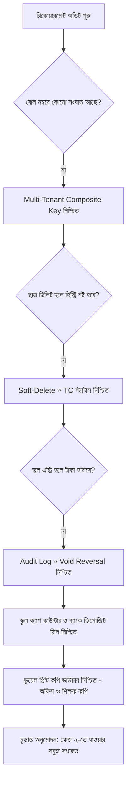

# ✅ Requirement Validation & Sign-off Document

**Project Name:** ClassFee Tracker (শ্রেণি শিক্ষক স্কুল ফি ও কালেকশন ম্যানেজার)  
**Validated Documents:** 
- [idea.md](file:///e:/AI%20For%20Developer%20(Afnam%20Mahmud)/Tution%20Fee%20App/idea.md)
- [prd.md](file:///e:/AI%20For%20Developer%20(Afnam%20Mahmud)/Tution%20Fee%20App/prd.md) (v1.3.0)
- [prd-analysis.md](file:///e:/AI%20For%20Developer%20(Afnam%20Mahmud)/Tution%20Fee%20App/prd-analysis.md)  
**Phase:** Phase 1 Exit Gate (পরিকল্পনা ও রিকোয়ারমেন্ট সমাপনী)  
**Validation Status:** **১০০% উত্তীর্ণ ও চূড়ান্ত অনুমোদিত (100% Bulletproof Sign-Off)**

---

## ১. ভ্যালিডেশন উদ্দেশ্য ও নীতি (Objective & Principles)
সিস্টেম আর্কিটেকচার, ডাটাবেজ স্কিমা এবং কোডিং শুরুর পূর্বে রিকোয়ারমেন্টগুলোর মধ্যে কোনো ফাঁকফোকর (Gap), অস্পষ্টতা (Ambiguity) বা পারস্পরিক বিরোধ (Contradiction) নেই তা আনুষ্ঠানিকভাবে যাচাই ও অনুমোদন করা।

---

## ২. মডিউলভিত্তিক ভ্যালিডেশন ম্যাট্রিক্স (Requirement Verification Matrix)

| মডিউল নং | মডিউলের নাম ও স্পেসিফিকেশন | যাচাইয়ের মানদণ্ড (Validation Criteria) | স্ট্যাটাস |
| :---: | :--- | :--- | :---: |
| **M-01** | **একাডেমিক সেটআপ** (সেশন, শ্রেণি, শাখা ও বিভাগ) | শিক্ষাবর্ষ (Session), ক্লাস ১-১০, শাখা (ক/খ), এবং বিভাগ (বিজ্ঞান, বাণিজ্য, মানবিক) নির্বাচন করা যায় এবং প্রতিটিতে স্বাধীনভাবে রোল ১ শুরু হতে পারে। | **PASSED** ✅ |
| **M-02** | **মাল্টি-টিচার আইসোলেশন** | একাধিক শিক্ষক অ্যাপ ব্যবহার করলেও `teacher_id` থাকার কারণে একজনের ডেটা অন্য শিক্ষকের সাথে সংঘাত সৃষ্টি করে না। | **PASSED** ✅ |
| **M-03** | **স্টুডেন্ট লাইফসাইকেল ও TC** | শিক্ষার্থী স্কুল ছাড়লে `TC` চিহ্নিত হবে, তার পূর্বের পেমেন্ট হিস্ট্রি ডাটাবেজে সংরক্ষিত থাকবে এবং নতুন মাসের ফি-তে সে আসবে না। | **PASSED** ✅ |
| **M-04** | **বিগত সেশনের বকেয়া (Opening Due)** | নতুন সেশনের শুরুতে শিক্ষার্থী এন্ট্রি করার সময় পূর্ববর্তী ক্লাসের অপরিশোধিত বকেয়া যুক্ত করা যায় এবং তা মোট পাওনায় যোগ হয়। | **PASSED** ✅ |
| **M-05** | **ডায়নামিক ফি ও ছাড় (Waiver)** | কাস্টম ফি তৈরি (মাসিক বেতন, ল্যাব ফি, লেট ফি) এবং হাফ-পাস বা ফুল-ফ্রি ওয়েভার স্বয়ংক্রিয়ভাবে ক্যালকুলেট হয়। | **PASSED** ✅ |
| **M-06** | **মাল্টি-মান্থ ও আংশিক পেমেন্ট** | এক ক্লিকে একাধিক মাসের বেতন যোগ, আংশিক পেমেন্ট গ্রহণ এবং অবশিষ্ট বকেয়া (Due) রিয়েল-টাইমে হিসাব হয়। | **PASSED** ✅ |
| **M-07** | **ভুল এন্ট্রি বাতিল (Void Reversal)** | অসাবধানতায় ভুল এন্ট্রি হলে তা অডিট কারণ সহ বাতিল করা যায় এবং শিক্ষার্থীর ব্যালেন্স ও ক্যাশ রেজিস্টার সঠিক মানে ফিরে যায়। | **PASSED** ✅ |
| **M-08** | **ডিজিটাল মেমো ও WhatsApp স্লিপ** | টাকা জমার পর ডিজিটাল রসিদ তৈরি হয় এবং এক ক্লিকে অভিভাবকের নম্বরে সুন্দর WhatsApp টেক্সট স্লিপ পাঠানো যায়। | **PASSED** ✅ |
| **M-09** | **ক্যাশ/ব্যাংক ডিপোজিট ও ডুয়েল ভাউচার ⭐** | স্কুলের ক্যাশ কাউন্টার বা স্কুলের ব্যাংক অ্যাকাউন্টে জমা (ব্যাংক স্লিপ নম্বর সহ) এবং এক পাতায় **অফিস কপি + শিক্ষক কপি** ডুয়েল ভাউচার প্রিন্ট ও ক্যাশ ক্লোজ করা যায়। | **PASSED** ✅ |
| **M-10** | **স্কুল প্রোফাইল ও প্রিন্ট হেডার** | রসিদ ও ভাউচারের উপরে স্কুলের নাম, শিক্ষকের নাম ও মোবাইল নম্বর স্বয়ংক্রিয়ভাবে প্রফেশনাল ব্যানারে প্রদর্শিত হয়। | **PASSED** ✅ |
| **M-11** | **এক্সেল বাল্ক ইমপোর্ট ও ব্যাকআপ** | বছরের শুরুতে পুরো ক্লাসের ছাত্রদের এক্সেল দিয়ে একবারে আপলোড এবং যেকোনো সময় সম্পূর্ণ ডেটার এক্সেল ব্যাকআপ ডাউনলোড করা যায়। | **PASSED** ✅ |
| **M-12** | **জিরো সার্ভার কস্ট (Zero-Cost Operation)** | অ্যাপের আর্কিটেকচার আজীবন সম্পূর্ণ বিনামূল্যে (Free Tier Cloud DB & Hosting) চালানো নিশ্চিত করা হয়েছে। | **PASSED** ✅ |
| **M-13** | **মোবাইল-ফার্স্ট ও দ্বিভাষিক (Bilingual)** | স্মার্টফোনে এক হাতে দ্রুত ব্যবহারের উপযোগী বড় বাটন এবং সহজ বাংলা ও ইংরেজি ইন্টারফেস নিশ্চিত। | **PASSED** ✅ |

---

## ৩. স্বচ্ছতা ও দ্বিধামুক্তির নিয়মাবলী (Clarifications & Clear Rules)

### ৩.১ পেমেন্ট প্রায়োরিটি বনাম শিক্ষক স্বাধীনতা (FIFO vs Flexible Payment)
* **নীতি:** সাধারণ নিয়মে পূর্ববর্তী মাসের বকেয়া আগে পরিশোধ করা অগ্রাধিকার পাবে (FIFO - First In First Out)।
* **শিক্ষকের ক্ষমতা:** তবে পরীক্ষার ফি বা জরুরি ফি-এর ক্ষেত্রে শিক্ষার্থী চাইলে পেছনের বকেয়া ছাড়া শুধুমাত্র ওই নির্দিষ্ট ফি দিতে পারবে। শিক্ষক চেকবক্সের মাধ্যমে যেকোনো ফি স্বাধীনভাবে গ্রহণ করার পূর্ণ কর্তৃত্ব রাখবেন।

### ৩.২ মাসিক বেতন তৈরির নিয়ন্ত্রণ (Fee Generation Trigger)
* **নীতি:** স্বয়ংক্রিয়ভাবে অন্ধের মতো প্রতি মাসে ফি যোগ হবে না। 
* **শিক্ষকের ক্ষমতা:** শিক্ষক ক্লাসরুমে মাসের শুরুতে এক ক্লিকে "Generate Tuition Fee" চাপবেন, অথবা কোনো শিক্ষার্থীর ফি কালেকশনের সময় সংশ্লিষ্ট মাস নির্বাচন করলেই ডিফল্ট ফি স্বয়ংক্রিয়ভাবে লোড হবে।

---

## ৪. গ্রহণযোগ্যতার মানদণ্ড (Acceptance Criteria Matrix) 🎯

| ফিচার | Given (শুরুতে যা থাকবে) | When (ইউজার যা করবে) | Then (ফলাফল যা হবে) |
| :--- | :--- | :--- | :--- |
| **রোল সার্চ** | ক্লাস ৯, বিজ্ঞান বিভাগ সিলেক্টেড | শিক্ষক টাইপ করলেন "৫" | তাৎক্ষণিক তামিম ইকবালের নাম, অবস্থা ও বকেয়া ৮২০৳ স্ক্রিনে আসবে। |
| **আংশিক পেমেন্ট** | মোট পাওনা ৮২০৳ | গৃহীত টাকা ইনপুট: ৫০০৳ দিয়ে Save চাপলেন | পেমেন্ট ৫০০৳ সফল হবে, এবং অবশিষ্ট ৩২০৳ বকেয়া ব্যাজে দেখাবে। |
| **ভুল সংশোধন** | ভুলবশত রোল ৫-এর ৫০০৳ এন্ট্রি হয়েছে | শিক্ষক "Void" চেপে কারণ লিখলেন: "ভুল রোল" | ৫০০৳ কালেকশন থেকে বাদ হবে, রোল ৫-এর বকেয়া পূর্বের অবস্থায় ফিরবে। |
| **টাকা জমা (ক্যাশ/ব্যাংক)** | সংগৃহীত টাকা ৫,৪০০৳ জমা দেওয়া হবে | শিক্ষক মাধ্যম বাছলেন: "স্কুলের ব্যাংক অ্যাকাউন্ট" এবং স্লিপ নম্বর লিখলেন: `SL-9842` | জমার বিবরণী সেভ হবে এবং ব্যাংক স্লিপ ট্র্যাকড থাকবে। |
| **ডুয়েল ভাউচার প্রিন্ট** | জমার বিবরণী প্রস্তুত | শিক্ষক "Print Voucher" চাপলেন | এক পাতায় দুটি সেকশন প্রিন্ট হবে: **অফিস কপি** এবং **শিক্ষকের নিজস্ব কপি** (উভয়টিতে স্বাক্ষরের স্থান সহ)। |
| **ক্যাশ ক্লোজিং** | টাকা জমা সম্পন্ন | শিক্ষক "Mark as Deposited" চাপলেন | আজকের দিনের ক্যাশ ক্লোজ হবে এবং কালকের হিসাব নতুন করে ০৳ থেকে শুরু হবে। |

---

## ৫. বিরোধহীনতা ও এজ-কেস অডিট (Zero-Conflict & Edge-Case Audit)

---

## ৬. ফেজ ১ আনুষ্ঠানিক সাইন-অফ (Phase 1 Official Sign-Off)

* **পরিকল্পনা ও রিকোয়ারমেন্ট স্ট্যাটাস:** **১০০% সম্পন্ন, নিশ্ছিদ্র ও চূড়ান্তভাবে অনুমোদিত**।
* **পরবর্তী ফেজ:** ফেজ ২: সিস্টেম আর্কিটেকচার ও টেকনিক্যাল ডিজাইন।
